# Data Visualization in R with ggplot2

<details><summary>Slide 01 — Data Visualization in R with ggplot2</summary>
<p>

**Data Visualization in R with ggplot2**

Dr. Chris Bird  
Texas A&M University – Corpus Christi

---
</p>
</details>

<details><summary>Slide 02 — Scientific Visualizations Should be Clear</summary>
<p>

* What is being plotted?
* What are the axes?
* What do the colors, shapes, & sizes represent?
* What is the message you want to convey?

* What’s wrong with this figure?

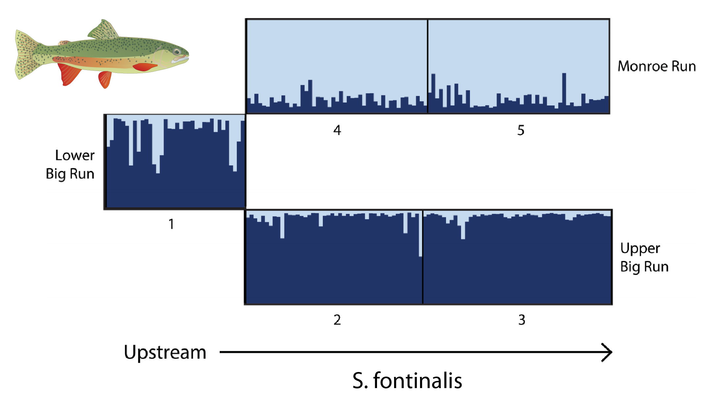

---
</p>
</details>

<details><summary>Slide 03 — Philosophy of ggplot2</summary>

### The Grammar of Graphics — Wilkinson (2006)

**The idea:** Describe a graph using text by specifying its components.

#### 1. The three basic components of a plot

| Component | What it describes | Examples |
|---|---|---|
| **Data** | The data frame to plot | |
| **Aesthetic mapping (`aes`)** | Which parts of the data frame are associated with which parts of the plot | X-axis, Y-axis, colors of points |
| **Geometry (`geom_`)** | How the data are drawn | Lines, points |

#### 2. Other components of the grammar

| Component | What it describes |
|---|---|
| **Coordinates** | Cartesian or polar |
| **Faceting** | Panels |
| **Statistics** | Fit lines, smoothing |
| **Theme** | Adjust the look and feel of the graphics |

---
</details>

<details><summary>Slide 04 — Make Sure You’ve Downloaded The R Script for this Lecture and Saved it Here:</summary>
<p>

`CSB\data_wrangling\sandbox\data_visualization_ggplot2.R`

* Run the following lines of code
  * Clear the environment
    * `rm(list=ls())`
  * Set the working directory to same location as this R script
    * !!! You should remember to copy this useful line of code into your future R scripts !!!
      * You’re welcome ☺

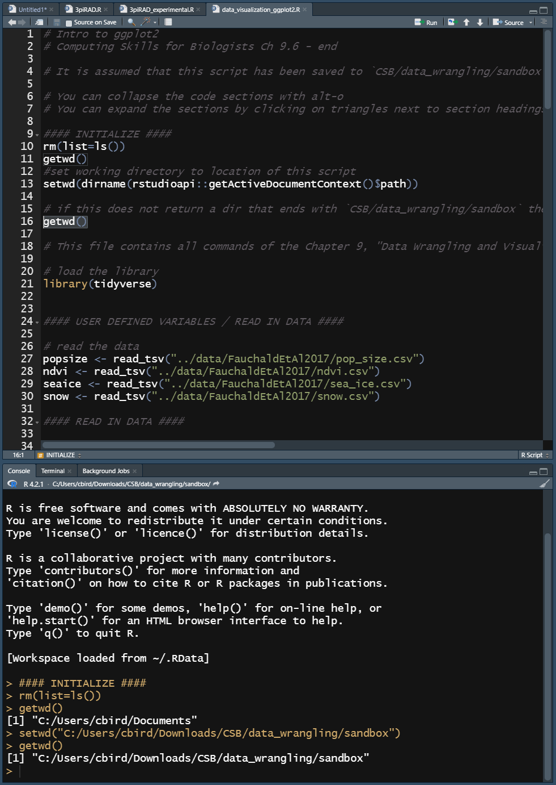

---
</p>
</details>

<details><summary>Slide 05 — Load Tidyverse</summary>
<p>

* Tidyverse
  * A package to manipulate data
  * The new commands we are using are part of “the tidyverse” as is ggplot2
  * Data frames are called “tibbles”
    * popsize, ndvi, seaice, & snow are tibbles
* `library(NameOfPackage)`
  * Adds commands to accomplish your tasks

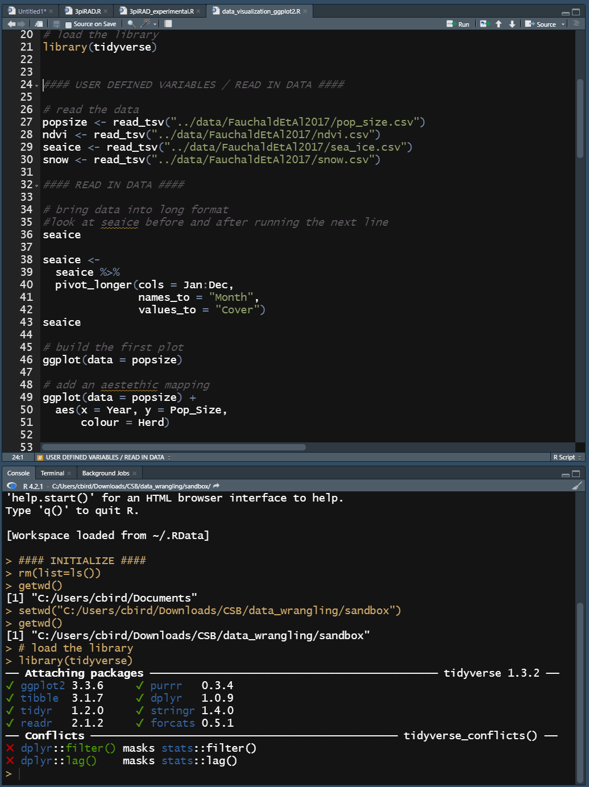

---
</p>
</details>

<details><summary>Slide 06 — User Defined Variables & Reading in Data</summary>
<p>

* All “hard-coded” variables should be defined in one location near the beginning of the script
  * Makes it easier to modify, no hunting for variables you need to change
  * Here they specify our input files
* New commands
  * `read_tsv(“path/to/file.tsv”)`
    * Reads in *.tsv files
    * Note the `_`, tidyverse and tidyv-compatible commands tend to use `_`, while non-tidyverse commands tend to use `.`

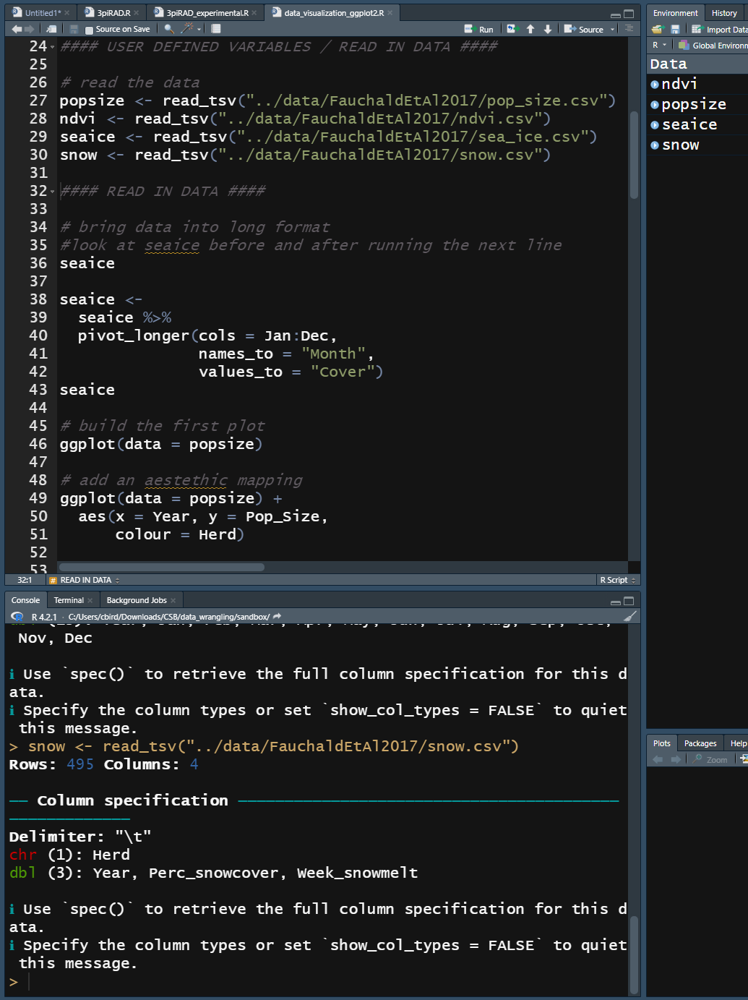

---
</p>
</details>

<details><summary>Slide 07</summary>
<p>

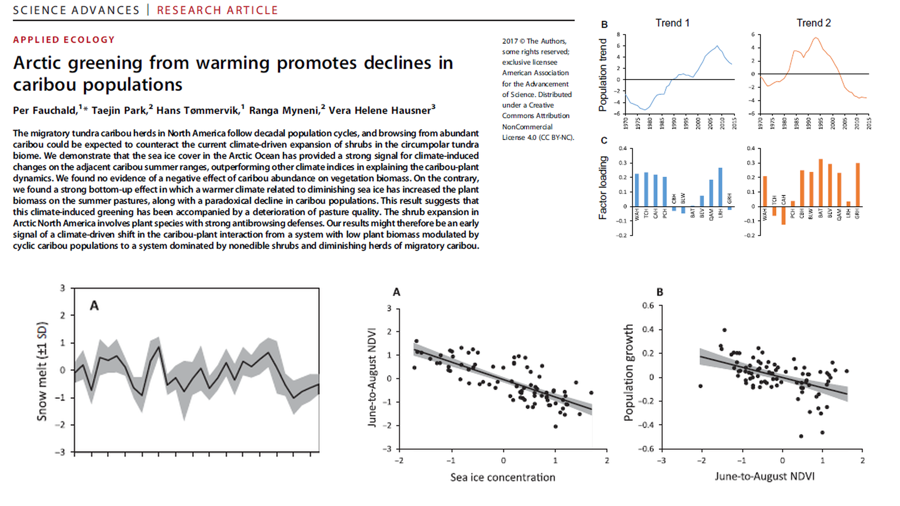

---
</p>
</details>

<details><summary>Slide 08 — Reading In Data</summary>
<p>

* All “hard-coded” variables should be defined in one location near the beginning of the script
  * Here they specify our input files
* New commands
  * `%>%` is a data pipe, like `|` in bash
    * `|>` was added to R 4.1 and above
    * `%>%` only works with tidyverse loaded
  * `pivot_longer()`

    ```r
    pivot_longer(
        cols=ColsToStack,
        names_to = NewColNameWithGrps,
        values_to = NewColWithValues
    )
    ```

    * Stacks data columns
    * Look at seaice before and after
  * `pivot_longer()`replaced `gather()`

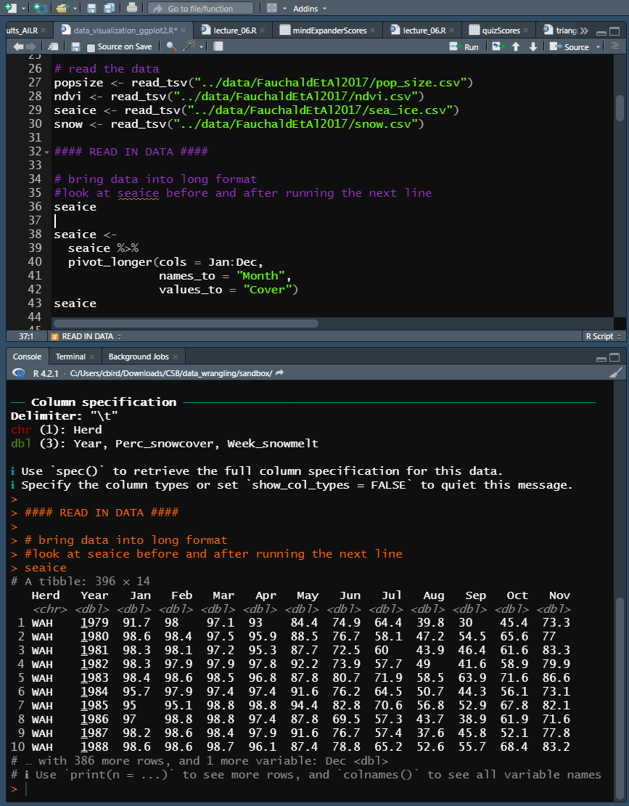

---
</p>
</details>

<details><summary>Slide 09 — Building a ggplot</summary>
<p>

* Plot Pop_Size vs Year by Herd
* Add data
  * data = popsize
* Add aesthetics (aes)
  * x = Year
  * y = Pop_Size
  * colour = herd
* Add data point geometry
  * `geom_point()`
* Add line geometry
  * `geom_line()`

* Note the use of + to continue the “sentence”

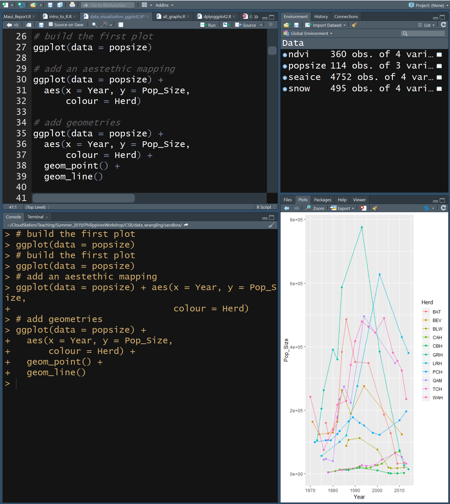

---
</p>
</details>

<details><summary>Slide 10 — Frequency Distribution</summary>
<p>

* Add data
  * data = ndvi
* Add aesthetics
  * `aes(x = NDVI_May)`
* Add data point geometry
  * `geom_histogram()`

* What is NDVI?
* Check Fauchald et al

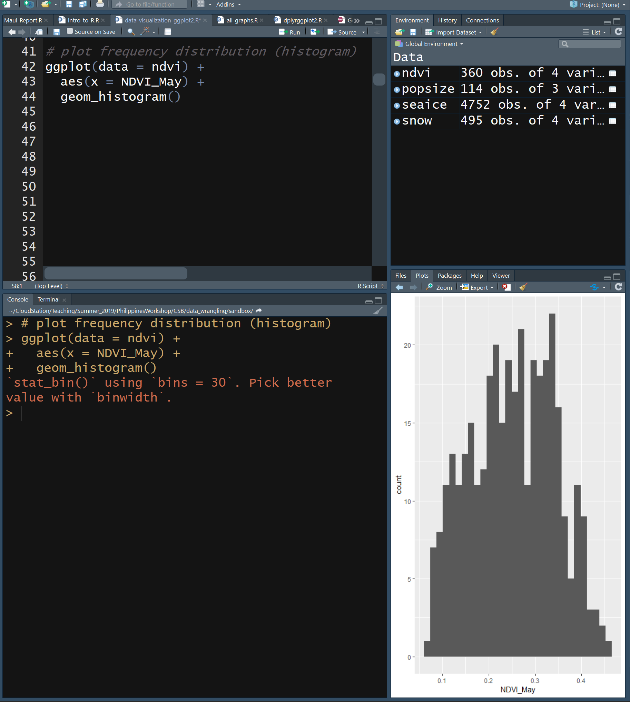

---
</p>
</details>

<details><summary>Slide 11 — Nested vs Unrolled</summary>
<p>

* The same plot can be made using the same commands arranged in different ways
* Nesting

  ```r
  ggplot(data = ndvi, aes(x = NDVI_May))
  ```

* Unrolled

  ```r
  ggplot(data = ndvi) +
    aes(x = NDVI_May) +
    geom_histogram()
  ```

* Note the use of + to continue the “sentence”

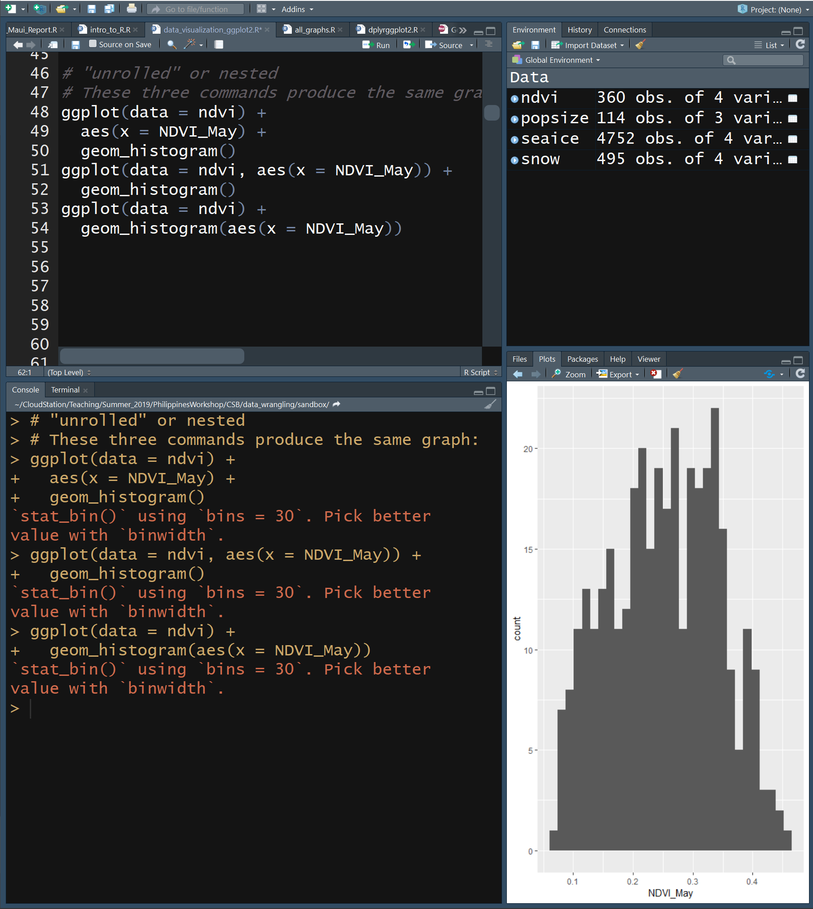

---
</p>
</details>

<details><summary>Slide 12 — Density Plot</summary>
<p>

* Interpolated from histogram

* Note the use of + to continue the “sentence”

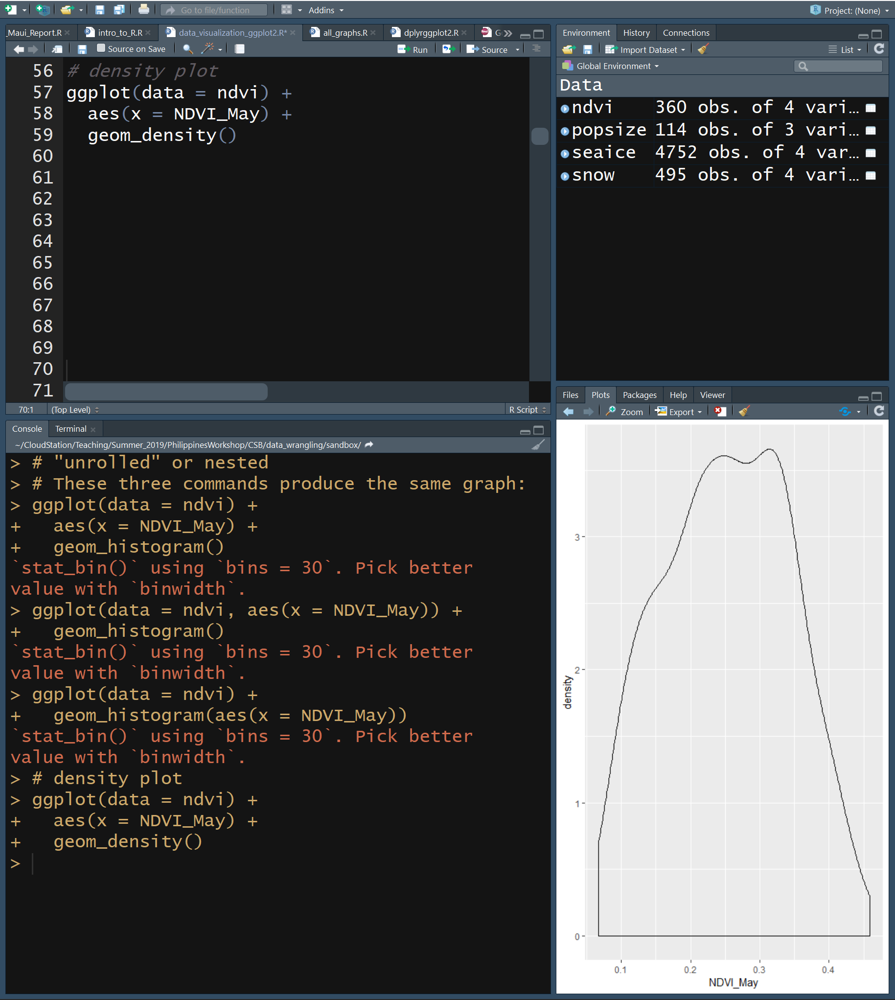

---
</p>
</details>

<details><summary>Slide 13 — Box & Violin Plots</summary>
<p>

* Provide info on distribution of your data
* Box plot
  * Box is 25, 50 & 75th percentiles
  * Whiskers are interquartile range, 1.5x length of box
  * Points are outliers
* Violin plot
  * Wider = more data points
* Plot can be assigned to variable
* Color can be added to plots using fill aesthetic

* Note the use of + to continue the “sentence”

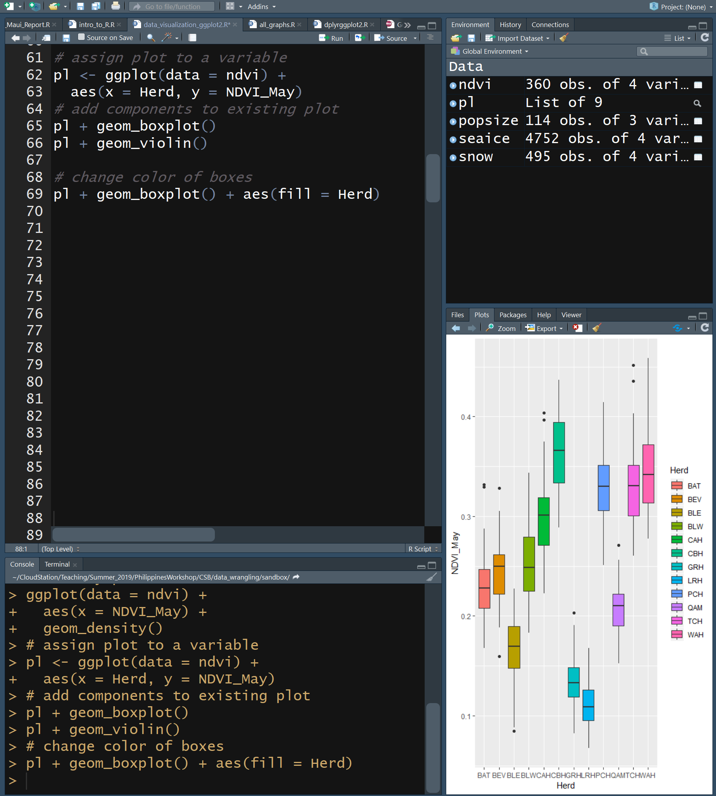

---
</p>
</details>

<details><summary>Slide 14 — Bar Plots</summary>
<p>

* Use bar plot to check if there’s 12 observations per year at site WAH
  * `geom_bar()`
    * counts up the number of times each year occurs
* New Tidyverse command
  * `filter(column == value)`
    * Subset data by value, results in fewer rows
* Plot cover of vegetation for each month in 1990
  * `geom_col()`
    * uses y to determine height of bar

* Note the use of + to continue the “sentence”

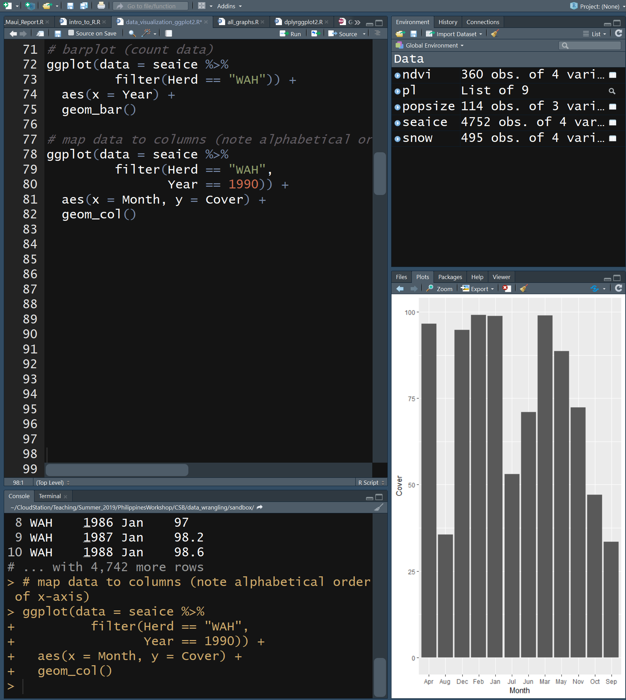

---
</p>
</details>

<details><summary>Slide 15 — Column Plots</summary>
<p>

* Notice in the last plot that the months are out of order
* New Tidyverse command
  * `mutate(ColName = Something)`
    * Change or add column values
  * `factor(column, format)`
    * Changes data type to factor and has predefined formats
* A factor is also an R data type
  * categorical variable
* Note that colplots use a categorical variable on x axis

* Note the use of + to continue the “sentence”

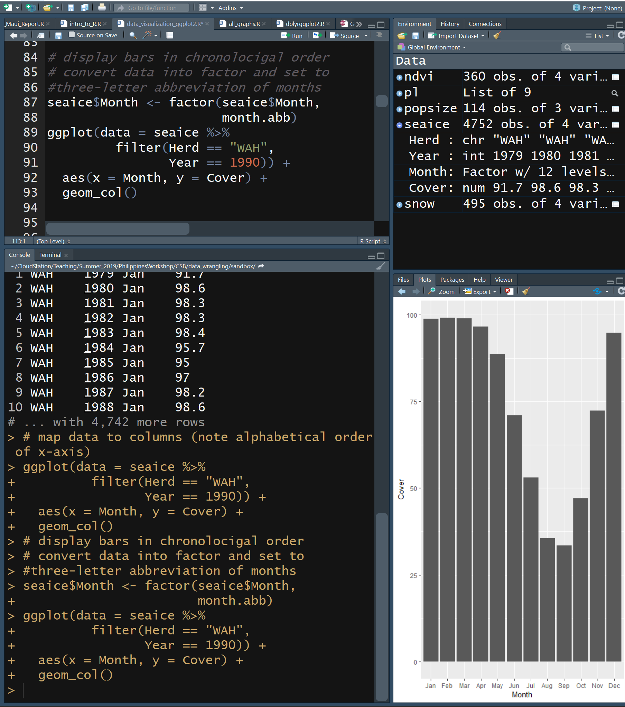

---
</p>
</details>

<details><summary>Slide 16 — Scatter Plots</summary>
<p>

* Visualize relationship between two continuous variables
* We can show plot in variable
  * `show(plotVarName)`
    * Displays plot
* Fit lines can be added
  * `geom_smooth()`
    * Uses loess smoother by default
  * `geom_smooth(method=“lm”)`
    * Linear model fit line
  * `geom_smooth(method=“lm”,    	formula = y ~ poly(x,3))`
    * 3rd order polymonial model fit line
  * `geom_smooth(se=FALSE)`
    * Remove error “ribbon”

* Note the use of + to continue the “sentence”

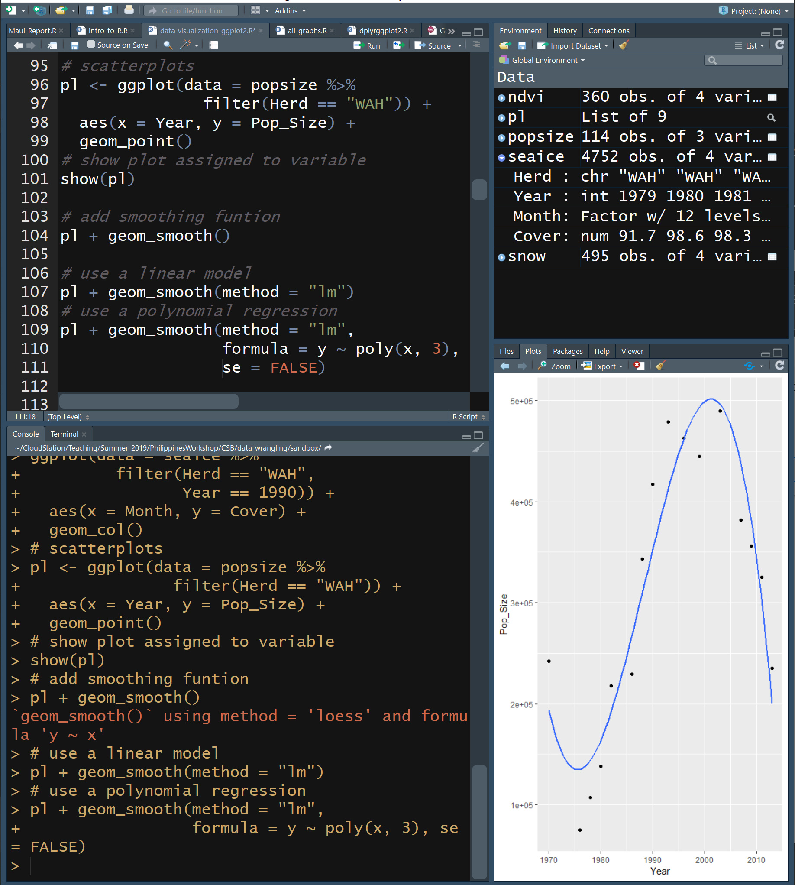

---
</p>
</details>

<details><summary>Slide 17 — Plotting Experimental Errors</summary>
<p>

* Error bars are typically plotted based upon values that you calculate
* New Tidyverse commands
  * `%in%`
    * Equals
  * `group_by(colName)`
    * Converts tibble into a grouped tibble where operations are performed by group
    * See ungroup()
  * `summarize()`
    * Returns requested summary stats by group
    * Look at stats
* Adding error bars
  * `geom_errorbar(ymax,ymin)`

* Note the use of + to continue the “sentence”

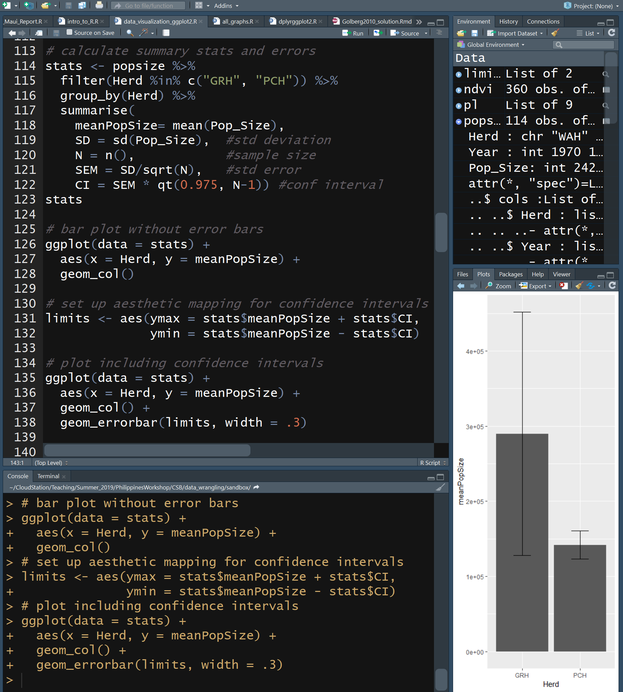

---
</p>
</details>

<details><summary>Slide 18</summary>
<p>

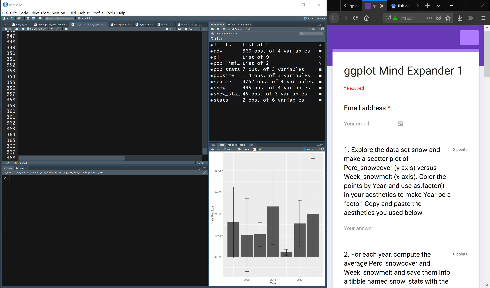

---
</p>
</details>

<details><summary>Slide 19 — Scales</summary>
<p>

* Modify the x and y axes, & determine how colors, sizes, shapes behave
* `fill`
  * Color fill an object
* `colour`
  * Color of border of object, point, line
  * I highly rec the RColorBrewer pkg
* `size`
  * Size of point
* `shape`
  * Shape of point
* `alpha`
  * Level of transparency of point or bar
* Discrete variables get discrete colors, continuous variables get continuous color
  * Compare pl1 to pl2

* Note the use of + to continue the “sentence”

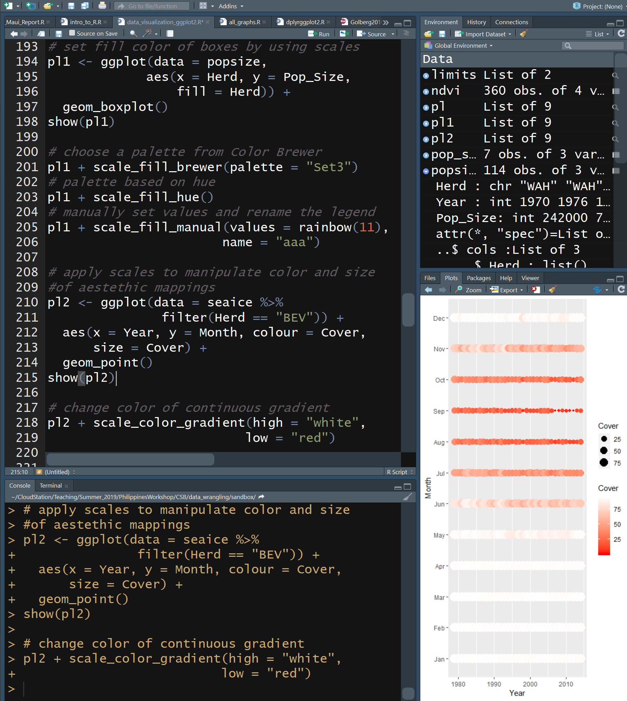

---
</p>
</details>

<details><summary>Slide 20 — RColorBrewer</summary>
<p>

* Package defining palettes of colors deemed to go together

* Note the use of + to continue the “sentence”

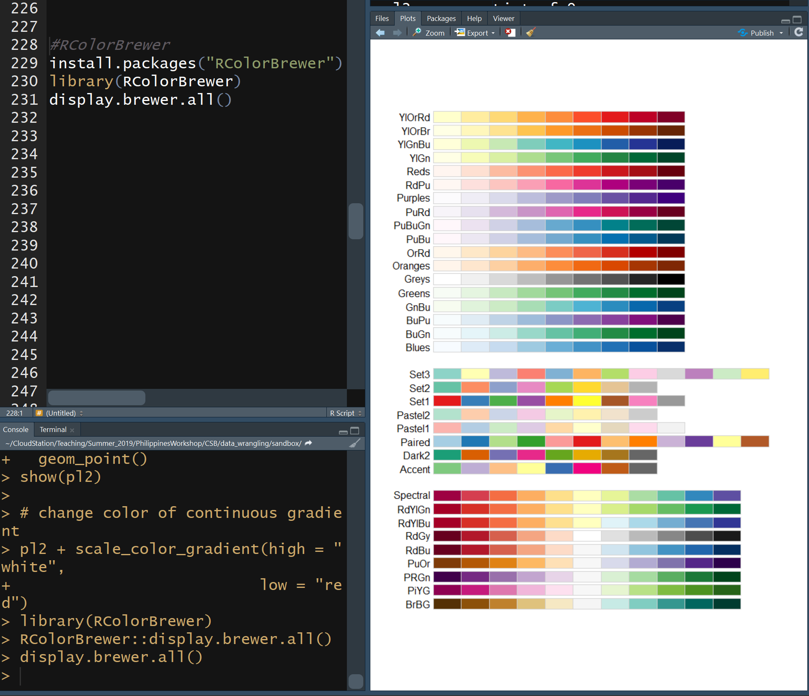

---
</p>
</details>

<details><summary>Slide 21 — Faceting</summary>
<p>

* Arrange like plots into panels by a categorical variable
* `facet_wrap(rowVar~colVar)`
  * Skips empty panels
* `facet_grid(rowVar~colVar)`
  * Does not skip empty panels
* Make figures to see how ice dynamics have changed through the decades

* Note the use of + to continue the “sentence”

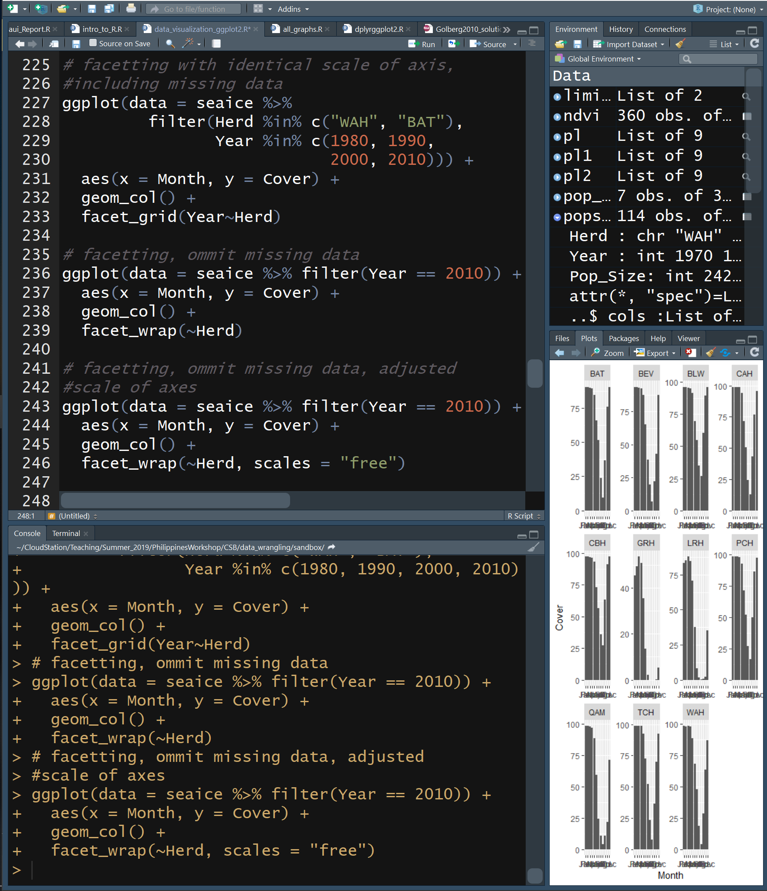

---
</p>
</details>

<details><summary>Slide 22 — Labels</summary>
<p>

* You can change axis and title labels
* `xlab(“Text”)`
  * X axis label
* `ylab(“Text”)`
  * Y axis label
* `ggtitle(“Text”)`
  * title

* Note the use of + to continue the “sentence”

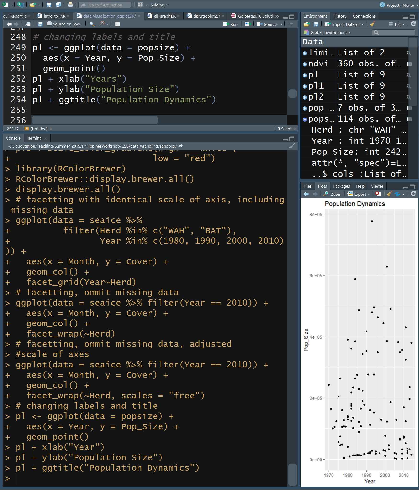

---
</p>
</details>

<details><summary>Slide 23 — Legends</summary>
<p>

* By default, legends are on the right, but you can control their position
* `theme(legend.position = “location”)`
* If the same column is mapped to both size and colour, one legend is made
* If different features of the data are mapped into different aesthetics, legends are made for each feature
* Each legend has guides() to change the legend title and features
  * For more info read documentation on guide_legend

* Note the use of + to continue the “sentence”

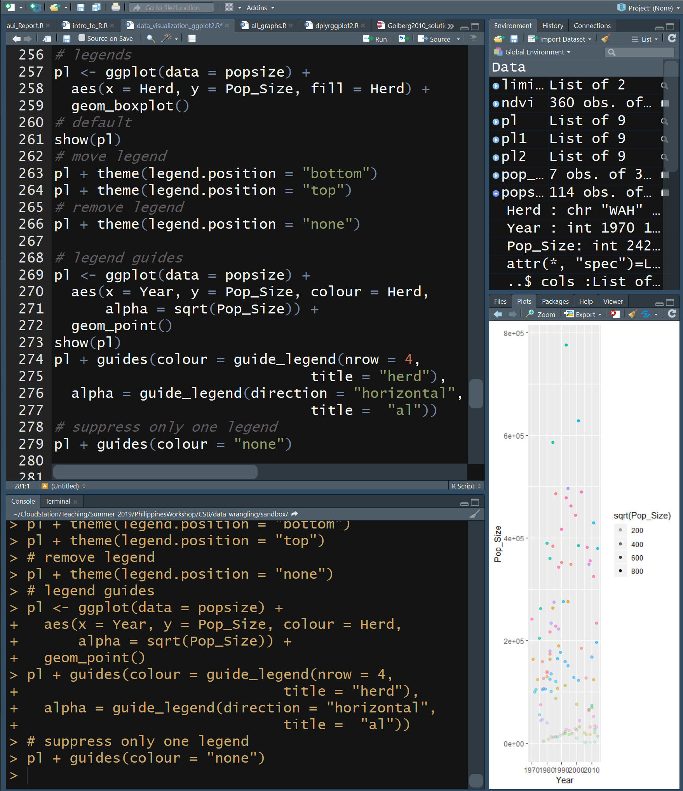

---
</p>
</details>

<details><summary>Slide 24 — Themes</summary>
<p>

* The general appearance of a plot can be controlled with themes
* `theme()`
  * Control each element of theme independently
  * See documentation
* There are several preset themes
  * `theme_bw()`
  * `theme_minimal()`
  * `theme_classic()`
* It’s possible to create your own themes
  * See documentation

* Note the use of + to continue the “sentence”

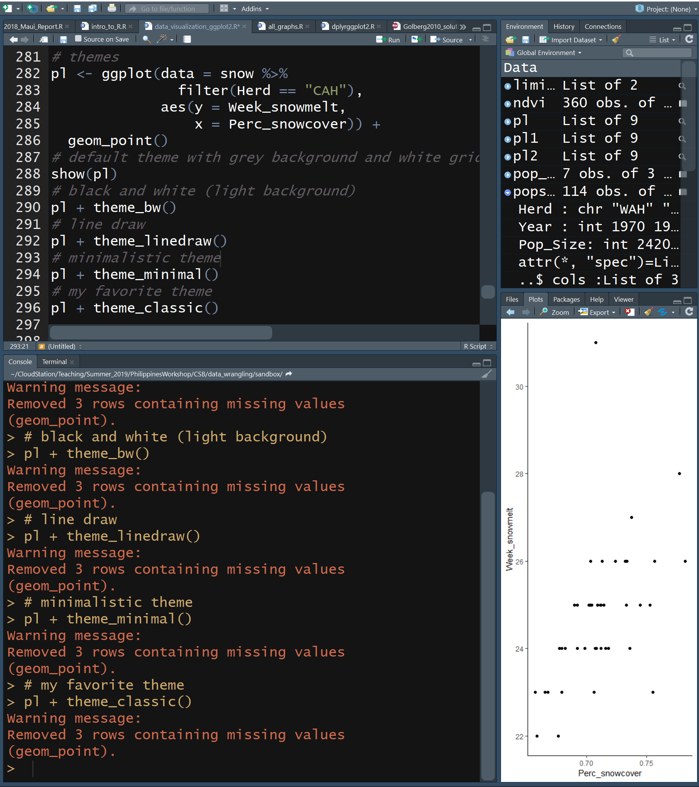

---
</p>
</details>

<details><summary>Slide 25 — Setting a Feature</summary>
<p>

* You can control the appearance of any and all features using ggplot
  * `geom_point(colour = “color”)`
  * Similarly, you can control size, shape, fill, alpha, and many other properties

* Note the use of + to continue the “sentence”

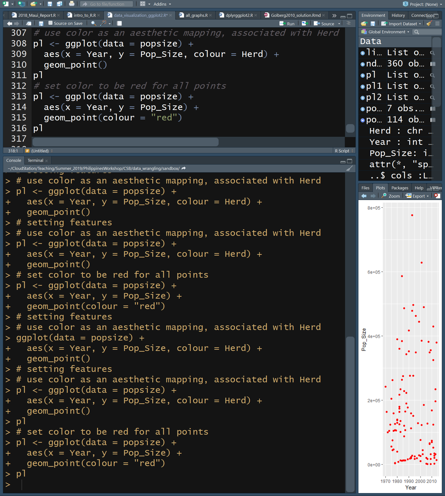

---
</p>
</details>

<details><summary>Slide 26 — Saving a Figure</summary>
<p>

* You can save your plots to a file with a certain size
* `ggsave(filename, plot,  	width, height)`
  * Control each element of theme independently
  * See documentation
* To save multiple plots to one file with each page being a different file, use:
  * `pdf(filename, plot,  	width, height)`
    * All plots between pdf() and dev.off() will be included. See documentation
  * `dev.off()`
* If you don’t set the size of the figure, it will be scaled by the dimensions of the figure panel in R Studio

* Note the use of + to continue the “sentence”

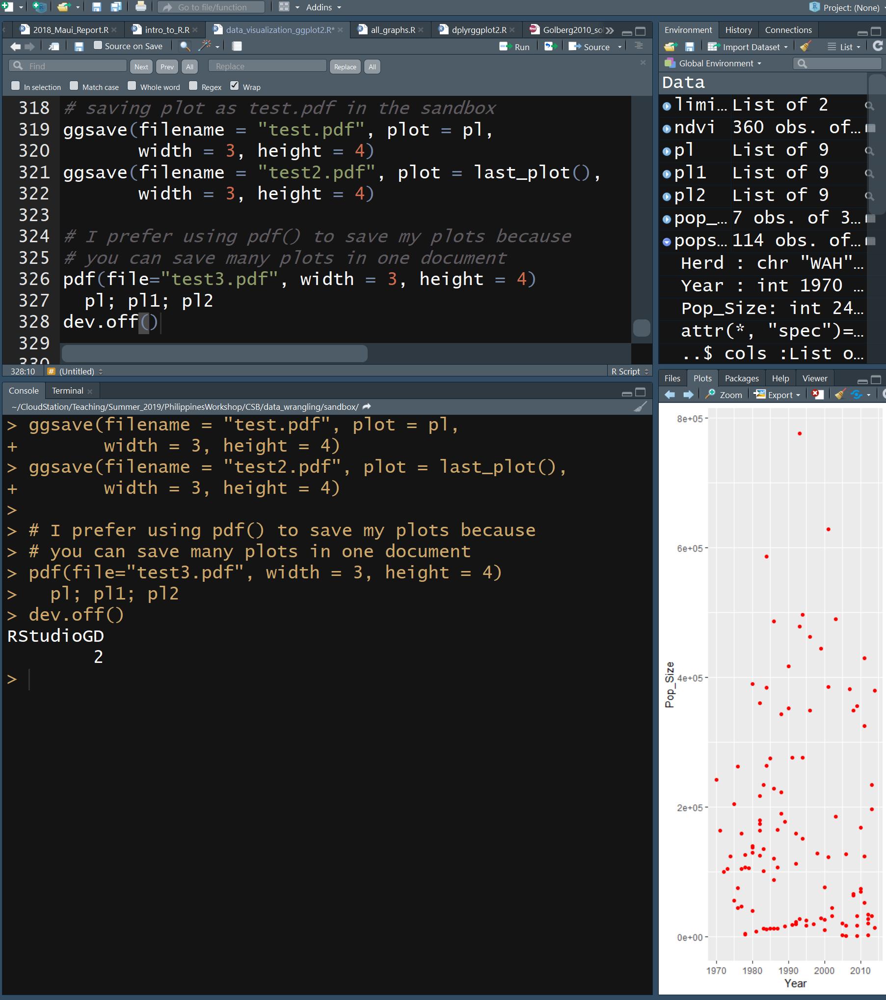

---
</p>
</details>

<details><summary>Slide 27</summary>
<p>

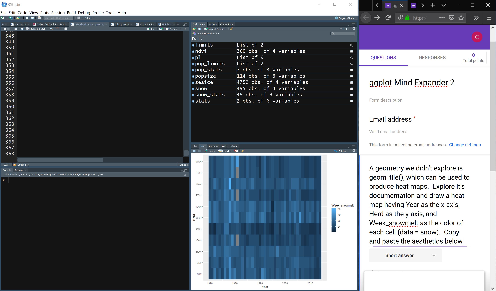

---
</p>
</details>
